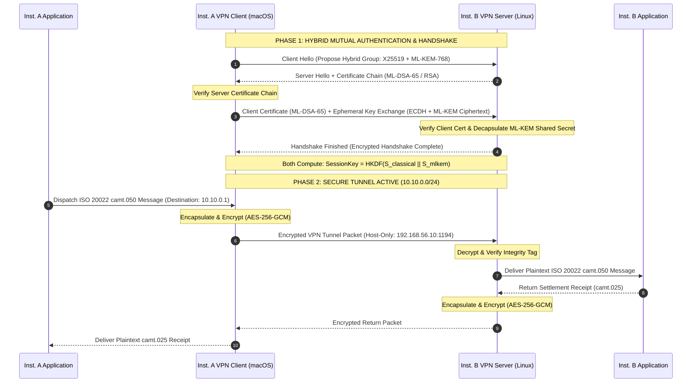

# SOFTWARE REQUIREMENTS SPECIFICATION (SRS)

## Project Title
**Hybrid Post-Quantum Secure VPN for Inter-Bank Communication**

**Document Version:** 1.0  
**Status:** Approved Baseline  
**Date:** September 2026  
**Institution:** University of Dodoma (UDOM)  
**College:** College of Informatics and Virtual Education (CIVE)  
**Department:** Department of Computer Science and Software Engineering  
**Programme:** Bachelor of Science in Software Engineering  
**Prepared by:** Candidate Name  
**Academic Year:** 2025/2026  

---

## Table of Contents
1. [Introduction](#1-introduction)
   - 1.1 Purpose
   - 1.2 Document Conventions
   - 1.3 Intended Audience and Reading Suggestions
   - 1.4 Project Scope
   - 1.5 Problem Statement
   - 1.6 Project Objectives (Main and Specific)
   - 1.7 Research Questions
   - 1.8 Definitions, Acronyms, and Abbreviations
   - 1.9 References
2. [Overall Description](#2-overall-description)
   - 2.1 Product Perspective & Context
   - 2.2 Operational Environment
   - 2.3 User Classes and Characteristics
   - 2.4 Design and Implementation Constraints
   - 2.5 Assumptions and Dependencies
3. [System & Network Architecture](#3-system--network-architecture)
   - 3.1 Simulated Financial Institution Model
   - 3.2 Physical & Virtual Network Topology (Host-Only Network)
   - 3.3 Overlay VPN Tunnel Network
   - 3.4 Cryptographic Layer Architecture
   - 3.5 Hybrid Key Derivation Architecture (FIPS 203 + Classical)
4. [Specific Functional Requirements](#4-specific-functional-requirements)
   - 4.1 Module 1: Network & Tunnel Orchestration
   - 4.2 Module 2: Authentication & Endpoint Verification
   - 4.3 Module 3: Cryptographic Negotiation & Key Establishment
   - 4.4 Module 4: Secure Data Transmission & Integrity
   - 4.5 Module 5: Cryptographic Agility Engine
   - 4.6 Module 6: Telemetry, Benchmarking & Experimentation
5. [Non-Functional Requirements (System Attributes)](#5-non-functional-requirements)
   - 5.1 Security Requirements
   - 5.2 Performance & Resource Overhead Requirements
   - 5.3 Reliability, Availability & Fault Tolerance
   - 5.4 Maintainability & Extensibility
   - 5.5 Cryptographic Agility
   - 5.6 Usability & Reproducibility
   - 5.7 Auditability & Compliance Logging
6. [Cryptographic Specifications & Algorithm Matrix](#6-cryptographic-specifications)
   - 6.1 Standardized Cryptographic Primitives (NIST FIPS Status)
   - 6.2 Parameter Sets and Security Categories
   - 6.3 Hybrid Combination Methodology
7. [Use Case Analysis & UML Diagrams](#7-use-case-analysis--uml-diagrams)
   - 7.1 Actor Descriptions
   - 7.2 Use Case Diagram
   - 7.3 Detailed Use Case Specifications (UC-01 to UC-06)
   - 7.4 Sequence Diagrams (Tunnel Handshake & Data Transfer)
8. [Performance Evaluation Framework & Test Metrics](#8-performance-evaluation-framework)
   - 8.1 Empirical Metrics Definition
   - 8.2 Workload Profiles & Sample Datasets
   - 8.3 Data Collection & Telemetry Methodology
9. [Security Verification & Fault Injection Scenarios](#9-security-verification)
   - 9.1 Threat Model
   - 9.2 Fault Injection & Negative Test Suites
10. [Verification & Acceptance Criteria](#10-verification--acceptance-criteria)
    - 10.1 Requirements Traceability Matrix (RTM)
    - 10.2 Acceptance Sign-off Matrix
11. [Project Phasing & Next Steps](#11-project-phasing--next-steps)

---

## 1. Introduction

### 1.1 Purpose
The purpose of this Software Requirements Specification (SRS) is to establish a rigorous, unambiguous engineering and scientific specification for the design, implementation, and empirical evaluation of a **Hybrid Post-Quantum Cryptographic Virtual Private Network (Hybrid PQC-VPN)**. 

This system protects inter-bank communications between simulated financial institutions against classical and quantum cryptanalytic attacks—notably the "Harvest Now, Decrypt Later" (HNDL) paradigm enabled by Shor's and Grover's quantum algorithms. This document defines the functional capabilities, performance criteria, security boundaries, architectural constraints, and evaluation methodologies required for academic examination at the University of Dodoma.

### 1.2 Document Conventions
- **Requirement Identifiers:** 
  - `FR-XX`: Functional Requirements
  - `NFR-XX`: Non-Functional Requirements
  - `UC-XX`: System Use Cases
  - `TEST-XX`: Security and Benchmark Scenarios
- **Prioritization Norms (RFC 2119):**
  - **SHALL / MUST:** Mandatory requirement without exception.
  - **SHOULD:** Recommended practice; requires technical justification if omitted.
  - **MAY:** Optional or exploratory capability.

### 1.3 Intended Audience and Reading Suggestions
1. **Academic Supervisors & External Examiners:** Focus on Sections 1.5–1.7, 3, 5, 6, 8, and 10 to evaluate research validity and engineering rigor.
2. **Student Developer / Author:** Use Sections 3, 4, 6, 7, and 9 as a daily technical blueprint for system implementation.
3. **Peer Evaluators / Reproducibility Researchers:** Refer to Sections 3.2, 8, and 9 to replicate experimental testbeds and benchmarking pipelines.

### 1.4 Project Scope
The project delivers a controlled, reproducible laboratory testbed comprising two communicating institutional endpoints:
- **Endpoint A (Simulated Institution A):** macOS host representing an originating central banking entity.
- **Endpoint B (Simulated Institution B):** Linux virtual machine running within Oracle VM VirtualBox representing a counterparty central banking or payment processing node.
- **Communication Pipeline:** Encrypted tunnel established over an isolated virtual host-only network, utilizing hybrid key establishment and quantum-resilient signatures.
- **Experimental Test Harness:** Automated benchmarking tooling to systematically measure cryptographic overhead, memory/CPU consumption, latency, throughput, and agility metrics across three operational modes: Classical, Post-Quantum, and Hybrid.

**Exclusions / Out-of-Scope:**
- Interfacing with actual live infrastructure belonging to the Banque de France, Deutsche Bundesbank, or the Eurosystem TARGET2/ESMIG services.
- Processing real financial customer data or live fiat transactions.
- Developing mathematical implementations of underlying cryptographic primitives (e.g., lattice polynomial arithmetic) from scratch; the project integrates standardized, audited cryptographic libraries (e.g., OpenSSL 3.x with liboqs / OQS-OpenSSL).
- Mathematical cryptanalysis or proof generation of lattice reduction algorithms.

### 1.5 Problem Statement
Financial Market Infrastructures (FMIs) and Real-Time Gross Settlement (RTGS) systems underpin global financial stability, settling transactions exceeding multiple times national GDP daily. These infrastructures depend upon asymmetric cryptographic algorithms (RSA, ECDH, ECDSA) for mutual authentication and session key establishment. 

However, cryptanalytically relevant quantum computers (CRQCs) running Shor's algorithm threaten to solve the integer factorization and discrete logarithm problems in polynomial time, rendering existing public-key cryptography obsolete. Furthermore, hostile adversaries are actively conducting **Harvest Now, Decrypt Later (HNDL)** operations, storing encrypted high-value financial traffic today to decrypt once quantum hardware matures.

Immediate, wholesale replacement of legacy financial infrastructure with pure Post-Quantum Cryptography (PQC) introduces severe operational risks: PQC algorithms possess larger public keys and ciphertext sizes, increased computational requirements, uncertain long-term cryptanalytic maturity, and an absence of backwards compatibility. 

Therefore, there is an urgent scientific and engineering need to design, implement, and benchmark **hybrid cryptographic mechanisms**—combining vetted classical algorithms with standardized post-quantum schemes—within a flexible, cryptographically agile VPN architecture tailored for inter-institutional financial communication.

### 1.6 Project Objectives

#### 1.6.1 Main Objective
To design, implement, and empirically evaluate a hybrid post-quantum secure Virtual Private Network that provides quantum-resilient communication between two simulated financial institutions while systematically quantifying the performance, computational, and architectural impacts of post-quantum migration.

#### 1.6.2 Specific Objectives
1. **Objective 1 (Architectural Design):** To design an isolated laboratory network architecture and hybrid cryptographic protocol model representing secure communication between two autonomous financial institutions.
2. **Objective 2 (Classical Baseline Implementation):** To implement a standards-compliant classical cryptographic VPN configuration (using RSA/ECDH and AES-GCM) that establishes a baseline for security and performance benchmarking.
3. **Objective 3 (Hybrid & PQC Implementation):** To implement a hybrid post-quantum VPN architecture combining classical primitives with NIST FIPS 203 (ML-KEM) for key encapsulation and NIST FIPS 204 (ML-DSA) for endpoint authentication.
4. **Objective 4 (Empirical Performance Evaluation):** To evaluate and benchmark tunnel establishment duration, handshake latency, CPU/RAM utilization, network throughput, and packet fragmentation overhead across Classical, Pure PQC, and Hybrid configurations under variable load.
5. **Objective 5 (Cryptographic Agility Assessment):** To evaluate the system’s cryptographic agility by testing dynamic switching, parameter adjustment (security levels 1 to 5), and algorithmic fault tolerance without restructuring the underlying VPN transport layer.

### 1.7 Research Questions
- **RQ1:** How can standardized post-quantum cryptographic primitives (ML-KEM, ML-DSA) be integrated into a client-server VPN architecture alongside classical mechanisms without altering core network transport protocols?
- **RQ2:** What are the measurable performance trade-offs (handshake duration, transmission latency, throughput degradation, resource consumption) between Classical, Pure PQC, and Hybrid VPN configurations in a controlled inter-bank simulation?
- **RQ3:** How do the substantially larger public-key and ciphertext footprints of lattice-based post-quantum cryptography impact network packet fragmentation, transmission overhead, and MTU configuration across institutional tunnels?
- **RQ4:** How does cryptographic agility enable financial network architectures to switch or deprecate compromised cryptographic algorithms while maintaining operational continuity?

### 1.8 Definitions, Acronyms, and Abbreviations
| Term / Acronym | Definition |
| :--- | :--- |
| **AES-GCM** | Advanced Encryption Standard in Galois/Counter Mode (Authenticated Encryption) |
| **API** | Application Programming Interface |
| **BAH** | Business Application Header (ISO 20022 message wrapper) |
| **CIVE** | College of Informatics and Virtual Education (UDOM) |
| **CRQC** | Cryptanalytically Relevant Quantum Computer |
| **ECDH / ECDSA** | Elliptic Curve Diffie-Hellman / Elliptic Curve Digital Signature Algorithm |
| **FIPS** | Federal Information Processing Standards (NIST) |
| **HNDL** | Harvest Now, Decrypt Later |
| **HSM** | Hardware Security Module |
| **KEM** | Key Encapsulation Mechanism |
| **KDF** | Key Derivation Function |
| **ML-DSA** | Module-Lattice-Based Digital Signature Algorithm (NIST FIPS 204, formerly CRYSTALS-Dilithium) |
| **ML-KEM** | Module-Lattice-Based Key-Encapsulation Mechanism (NIST FIPS 203, formerly CRYSTALS-Kyber) |
| **MTU** | Maximum Transmission Unit |
| **NIST** | National Institute of Standards and Technology (USA) |
| **OQS** | Open Quantum Safe project (liboqs, OQS-OpenSSL) |
| **PQC** | Post-Quantum Cryptography |
| **PKE** | Public Key Encryption |
| **QKD** | Quantum Key Distribution (hardware-dependent physics-based mechanism) |
| **RTGS** | Real-Time Gross Settlement |
| **RTM** | Requirements Traceability Matrix |
| **SLH-DSA** | Stateless Hash-Based Digital Signature Algorithm (NIST FIPS 205, formerly SPHINCS+) |
| **SRS** | Software Requirements Specification |
| **UDOM** | University of Dodoma |
| **VPN** | Virtual Private Network |
| **X25519** | Elliptic Curve Diffie-Hellman function over Curve25519 |

### 1.9 References
1. NIST FIPS 203 (2024), *Module-Lattice-Based Key-Encapsulation Mechanism Standard*, National Institute of Standards and Technology.
2. NIST FIPS 204 (2024), *Module-Lattice-Based Digital Signature Standard*, National Institute of Standards and Technology.
3. NIST FIPS 205 (2024), *Stateless Hash-Based Digital Signature Standard*, National Institute of Standards and Technology.
4. Bank for International Settlements (BIS) Innovation Hub, Banque de France, & Deutsche Bundesbank (June 2023), *Project Leap: Quantum-proofing the financial system (Phase 1 Report)*.
5. Bank for International Settlements (BIS) Innovation Hub, Bank of Italy, Banque de France, Deutsche Bundesbank, Nexi-Colt, & Swift (December 2025), *Project Leap: Quantum-proofing payment systems (Phase 2 Report)*.
6. Mosca, M. (2021), *Cybersecurity in an Era with Quantum Computers: Will We Be Ready?*, IEEE Security & Privacy.
7. Open Quantum Safe (OQS) Project, *liboqs: C library for quantum-resistant cryptographic algorithms*, https://openquantumsafe.org.
8. ISO 20022 Standard, *Financial Services - Universal financial industry message scheme*.

---

## 2. Overall Description

### 2.1 Product Perspective & Context
The proposed system is an experimental cyber-physical software artifact. It serves as a secure, quantum-resistant communication gateway between two autonomous institutional nodes. The system sits between higher-level financial application workloads (such as ISO 20022 transaction generators) and the untrusted physical/virtual network infrastructure.

```
+---------------------------------------------------------------------------------+
|                    SIMULATED FINANCIAL WORKLOAD LAYER                           |
|             (ISO 20022 camt.050 / pacs.008 Liquidity Messages)                  |
+---------------------------------------------------------------------------------+
                                      |
                                      v
+---------------------------------------------------------------------------------+
|                      HYBRID PQC-VPN SYSTEM (THIS PROJECT)                       |
|  +--------------------+   +---------------------+   +------------------------+  |
|  | Cryptographic      |   | Tunnel Engine &     |   | Telemetry &            |  |
|  | Agility Controller |   | Transport Wrapper   |   | Performance Benchmarks |  |
|  +--------------------+   +---------------------+   +------------------------+  |
+---------------------------------------------------------------------------------+
                                      |
                                      v
+---------------------------------------------------------------------------------+
|                   VIRTUAL HOST-ONLY NETWORK ENVIRONMENT                         |
|           (Isolated VirtualBox Network: macOS Host <-> Linux Guest)             |
+---------------------------------------------------------------------------------+
```

### 2.2 Operational Environment
The laboratory system operates across a dual-platform physical-virtual topology:

#### Endpoint A (Simulated Institution A - "Banque de France")
- **Hardware Platform:** Apple Silicon / x86_64 macOS Host.
- **Operating System:** macOS (Sonoma / Sequoia).
- **Core Software:** OpenVPN / strongSwan user-space tooling, OpenSSL 3.x with liboqs provider, Python 3.10+ execution runtime.
- **Network Interface:** VirtualBox Host-Only Adapter (`vboxnet0` or designated virtual interface, IP: `192.168.56.1`).

#### Endpoint B (Simulated Institution B - "Deutsche Bundesbank")
- **Virtualization Hypervisor:** Oracle VM VirtualBox.
- **Guest Operating System:** Ubuntu LTS (64-bit Server/Desktop).
- **Allocated Virtual Resources:** Minimum 2 vCPUs, 4096 MB RAM, 25 GB Virtual Disk.
- **Core Software:** OpenVPN / strongSwan daemon, OpenSSL 3.x with OQS provider, build-essential, iproute2, tcpdump, iperf3.
- **Network Interface:** VirtualBox Host-Only Adapter (`enp0s3` or `eth0`, IP: `192.168.56.10`).

#### Interconnecting Network
- Subnet: `192.168.56.0/24` (Physical/Host-Only emulation layer).
- Subnet: `10.10.0.0/24` (Encrypted Tunnel overlay network: Client `10.10.0.2`, Server `10.10.0.1`).

### 2.3 User Classes and Characteristics
1. **Security Engineer / VPN Administrator (Primary Actor):**
   - Profile: Software Engineering student / researcher with knowledge of computer networking, Linux systems administration, and applied cryptography.
   - Duties: Provisions cryptographic material, manages system configurations, switches operational modes (Classical/PQC/Hybrid), monitors audit logs.
2. **Benchmarking / Evaluation Harness (System Actor):**
   - Profile: Automated Python/Shell telemetry execution agent.
   - Duties: Injects message payloads, initiates repeated handshakes, samples system metrics (CPU, RAM, latency, packet sizes), aggregates statistical distributions.

### 2.4 Design and Implementation Constraints
- **C-01 (Algorithm Integrity):** No proprietary or unverified mathematical implementations of PQC primitives may be written. The system must strictly link against NIST-standardized implementations (OQS liboqs / OpenSSL provider).
- **C-02 (Hardware Constraints):** The architecture must function within standard consumer laptop hardware constraints (macOS host running a single concurrent Linux VM) without requiring dedicated physical Hardware Security Modules (HSMs).
- **C-03 (Isolation):** All network communication must remain confined to local virtualized host-only networks to prevent unverified experimental traffic from traversing public networks.
- **C-04 (Academic Verifiability):** All code, scripts, configuration files, and benchmark raw logs must be modular and documented to ensure complete third-party academic reproducibility.

### 2.5 Assumptions and Dependencies
- **A-01:** The hypervisor host-only networking adapter maintains consistent packet transmission without emulated packet loss unless deliberately injected.
- **A-02:** Modern cryptographic libraries (OpenSSL 3.x and liboqs) remain stable and adhere to final NIST FIPS 203, FIPS 204, and FIPS 205 specifications.
- **A-03:** Both endpoints share synchronized system clocks (via host synchronization or NTP) for precise latency and handshake duration measurements.

---

## 3. System & Network Architecture

### 3.1 Simulated Financial Institution Model
The design isolates organizational responsibilities between the two simulated endpoints:
- **Institution A (MacBook Host):** Acts as the Initiating Institution (Client). It houses financial message origination software, the PQC client engine, and local telemetry collectors.
- **Institution B (Linux VM):** Acts as the Responding Settlement Institution (Server Gateway). It hosts the secure VPN termination service, verification engine, and server-side resource monitors.

### 3.2 Network Layering & Topology

```
+-----------------------------------------------------------------------------------+
|  ENDPOINT A: macOS Host                                                           |
|  Simulated Institution A                                                          |
|  Physical IP: 192.168.56.1                                                        |
|  Tunnel Virtual IP: 10.10.0.2                                                     |
+-----------------------------------------------------------------------------------+
                                         |
                                         |  VirtualBox Host-Only Network (vboxnet0)
                                         |  Subnet: 192.168.56.0/24
                                         |  Untrusted Underlay Transport
                                         |
+-----------------------------------------------------------------------------------+
|  ENDPOINT B: Linux Guest VM                                                       |
|  Simulated Institution B                                                          |
|  Physical IP: 192.168.56.10                                                       |
|  Tunnel Virtual IP: 10.10.0.1                                                     |
+-----------------------------------------------------------------------------------+

=====================================================================================
OVERLAY ENCRYPTED TUNNEL: Subnet 10.10.0.0/24
Data Payloads: ISO 20022 Financial Messages (camt.050 Liquidity Transfers)
Encryption: AES-256-GCM
Key Establishment: Hybrid (X25519/ECDH + ML-KEM-768 via HKDF)
Authentication: Dual/Hybrid X.509 (RSA/ECDSA + ML-DSA-65)
=====================================================================================
```

### 3.3 Cryptographic Layer Architecture
The system decouples network transport from cryptographic primitives through an abstract Cryptographic Provider interface:

```
+-----------------------------------------------------------------------------------+
|                           VPN TRANSPORT / CONTROL ENGINE                          |
+-----------------------------------------------------------------------------------+
                                         |
                                         v
+-----------------------------------------------------------------------------------+
|                        CRYPTOGRAPHIC AGILITY PROVIDER                             |
+-----------------------------------------------------------------------------------+
         |                                |                               |
         v                                v                               v
+------------------+             +------------------+            +------------------+
| CLASSICAL ENGINE |             |    PQC ENGINE    |            |  HYBRID ENGINE   |
| - Key: X25519/RSA|             | - Key: ML-KEM    |            | - KDF combiner   |
| - Sign: RSA/ECDSA|             | - Sign: ML-DSA   |            | - Dual Signature |
| - Cipher: AES-GCM|             | - Cipher: AES-GCM|            | - Cipher: AES-GCM|
+------------------+             +------------------+            +------------------+
```

### 3.4 Hybrid Key Derivation Architecture (FIPS 203 + Classical)
The hybrid mechanism enforces defense-in-depth: if either classical mathematics or post-quantum module lattices are cracked, the session key remains uncompromised.

```
       [ Classical Key Exchange ]                 [ ML-KEM Key Encapsulation ]
           (e.g., ECDH X25519)                         (FIPS 203 ML-KEM-768)
                    |                                            |
                    v                                            v
         +--------------------+                       +--------------------+
         |  Classical Secret  |                       |     PQC Secret     |
         |       (S_c)        |                       |       (S_pq)       |
         +--------------------+                       +--------------------+
                    \                                            /
                     \                                          /
                      v                                        v
                    +--------------------------------------------+
                    |  CONCATENATION & CONTEXT EXTRACTION        |
                    |            Input: S_c || S_pq              |
                    +--------------------------------------------+
                                         |
                                         v
                    +--------------------------------------------+
                    |  HYBRID KEY DERIVATION FUNCTION (HKDF)     |
                    |     HKDF-Extract(Salt, S_c || S_pq)        |
                    |     HKDF-Expand(PRK, Context, Length)      |
                    +--------------------------------------------+
                                         |
                                         v
                    +--------------------------------------------+
                    |         FINAL SYMMETRIC SESSION KEY        |
                    |                (AES-256-GCM)               |
                    +--------------------------------------------+
```

---

## 4. Specific Functional Requirements

### 4.1 Module 1: Network & Tunnel Orchestration
- **FR-01 (Tunnel Lifecycle Management):** The system SHALL provide automated scripts and command interfaces to initialize, configure, start, verify, and terminate the VPN tunnel between Endpoint A and Endpoint B.
- **FR-02 (Virtual Interface Configuration):** The system SHALL provision point-to-point virtual tun/tap network interfaces on both endpoints (`tun0`), binding Endpoint A to `10.10.0.2` and Endpoint B to `10.10.0.1`.
- **FR-03 (Routing & IP Enforcement):** The system SHALL route traffic addressed to `10.10.0.0/24` exclusively through the encrypted virtual tunnel interface while preserving underlying host-only connectivity.

### 4.2 Module 2: Authentication & Endpoint Verification
- **FR-04 (Endpoint Mutual Authentication):** The system SHALL enforce mutual cryptographic authentication between client and server before establishing tunnel transport sessions.
- **FR-05 (Multi-Algorithm Certificate Handling):** The system SHALL support verification of X.509 digital certificates containing:
  - Classical keys: RSA (2048/4096-bit) and ECDSA (NIST P-256/P-384).
  - Post-Quantum keys: ML-DSA-44, ML-DSA-65, and ML-DSA-87 (NIST FIPS 204).
  - Optional exploratory keys: SLH-DSA (NIST FIPS 205) and Falcon/FN-DSA.
- **FR-06 (Invalid Certificate Rejection):** The system SHALL immediately terminate tunnel negotiation and issue a security exception if a certificate is expired, self-signed without trust root, structurally malformed, or signed by an untrusted CA.

### 4.3 Module 3: Cryptographic Negotiation & Key Establishment
- **FR-07 (Mode Selection):** The system SHALL allow the administrator to select between three explicit operational cryptographic modes via configuration files:
  - `MODE_CLASSICAL`: Classical key exchange and classical signature.
  - `MODE_PQC`: Pure post-quantum key encapsulation and post-quantum signature.
  - `MODE_HYBRID`: Combined classical and post-quantum key agreement.
- **FR-08 (Classical Key Agreement):** In `MODE_CLASSICAL`, the system SHALL negotiate session keys using ECDH (Curve25519/X25519) or RSA key exchange.
- **FR-09 (Post-Quantum Key Encapsulation):** In `MODE_PQC`, the system SHALL generate and encapsulate shared secrets using NIST FIPS 203 ML-KEM (ML-KEM-512, ML-KEM-768, or ML-KEM-1024).
- **FR-10 (Hybrid Session Key Derivation):** In `MODE_HYBRID`, the system SHALL combine classical shared secrets ($S_c$) and post-quantum shared secrets ($S_{pq}$) using a standards-aligned Key Derivation Function (HKDF-SHA384 or OpenSSL combined hybrid KEM groups) to produce an authoritative 256-bit symmetric key.

### 4.4 Module 4: Secure Data Transmission & Integrity
- **FR-11 (Bulk Traffic Encryption):** The system SHALL encrypt all payload data traversing the tunnel using authenticated symmetric encryption (AES-256-GCM or ChaCha20-Poly1305).
- **FR-12 (Data Integrity & Anti-Replay):** The system SHALL verify packet integrity and anti-replay counters for every encapsulated packet, silently discarding tampered or duplicate packets.
- **FR-13 (Test Financial Payload Dispatcher):** The system SHALL provide a test dispatcher capable of transmitting structured ISO 20022 XML financial messages (`camt.050` liquidity transfers and `pacs.008` credit transfers) over the tunnel from Endpoint A to Endpoint B.

### 4.5 Module 5: Cryptographic Agility Engine
- **FR-14 (Dynamic Parameter Configuration):** The system SHALL allow reconfiguration of cryptographic suites, parameter strengths (e.g., transitioning from ML-KEM-512 to ML-KEM-1024), and hybrid combinations through declarative configuration files without recompiling VPN source code.
- **FR-15 (Negotiation Failure Fallback Prevention):** The system SHALL explicitly forbid unauthenticated downgrade to unencrypted or unapproved classical modes when operating in `MODE_HYBRID` or `MODE_PQC`.

### 4.6 Module 6: Telemetry, Benchmarking & Experimentation
- **FR-16 (Automated Experiment Orchestrator):** The system SHALL provide an automated benchmarking harness that executes iterative test batches (minimum $N=50$ iterations per configuration).
- **FR-17 (Latency & Handshake Timing):** The system SHALL measure and record:
  - Initial connection setup duration (milliseconds).
  - Cryptographic key exchange duration (milliseconds).
  - Round-trip ping latency across the tunnel (milliseconds).
- **FR-18 (System Resource Telemetry):** The system SHALL sample and log CPU utilization percentage and memory consumption (RSS in megabytes) of VPN processes during handshake and continuous transmission.
- **FR-19 (Throughput & Network Profiling):** The system SHALL measure bandwidth throughput (Mbps) using controlled test payloads (1 MB, 10 MB, 50 MB) and record total transmitted packet byte counts.
- **FR-20 (Telemetry Export):** The system SHALL export all collected benchmark metrics in structured JSON and CSV formats for statistical analysis.

---

## 5. Non-Functional Requirements (System Attributes)

### 5.1 Security Requirements
- **NFR-01 (Standardized Primitives):** All cryptographic operations SHALL rely exclusively on vetted implementations compliant with NIST FIPS 203, FIPS 204, and FIPS 205 via OpenSSL 3.x / liboqs. Proprietary cryptographic implementations are strictly forbidden.
- **NFR-02 (Post-Quantum Security Levels):** The system SHALL support algorithms matching NIST Security Categories 1, 3, and 5:
  - Level 1: Computational equivalence to breaking AES-128 (e.g., ML-KEM-512).
  - Level 3: Computational equivalence to breaking AES-192 (e.g., ML-KEM-768, ML-DSA-65).
  - Level 5: Computational equivalence to breaking AES-256 (e.g., ML-KEM-1024, ML-DSA-87).
- **NFR-03 (Forward Secrecy):** The system SHALL ensure Perfect Forward Secrecy (PFS); compromising long-term institutional private keys must not allow retrospective decryption of past recorded sessions.

### 5.2 Performance & Resource Overhead Requirements
- **NFR-04 (Handshake Overhead Boundary):** Hybrid and PQC tunnel establishment duration SHALL NOT exceed 5.0 times the classical baseline under identical network conditions.
- **NFR-05 (Steady-State Transmission Parity):** Bulk data transfer throughput across an established tunnel SHALL NOT degrade by more than 10% between Classical and Hybrid modes, as bulk data in both modes is processed using symmetric AES-256-GCM.
- **NFR-06 (Resource Efficiency):** Memory consumption of the VPN daemon during peak cryptographic negotiation SHALL NOT exceed 128 MB on either endpoint.

### 5.3 Reliability, Availability & Fault Tolerance
- **NFR-07 (Connection Stability):** An established tunnel SHALL maintain active data integrity without crash, memory leak, or desynchronization over continuous 8-hour operational tests.
- **NFR-08 (Graceful Error Handling):** Upon receiving invalid cryptographic negotiation packets or corrupted certificates, the system SHALL log an error and cleanly reset state without crashing the daemon process.

### 5.4 Maintainability & Extensibility
- **NFR-09 (Modular Architecture):** The codebase and scripts SHALL adhere to modular separation: network scripts, cryptographic configurations, and benchmarking drivers must be distinct components.
- **NFR-10 (Configuration Decoupling):** All IP addresses, port numbers, key paths, and algorithm names SHALL be stored in external configuration files (`.conf`, `.env`, or `.json`) rather than hardcoded in scripts.

### 5.5 Cryptographic Agility
- **NFR-11 (Algorithm Substitutability):** Transitioning between different PQC algorithm families or parameter sets SHALL require no modifications to routing rules, network interfaces, or application-level message formats.

### 5.6 Usability & Reproducibility
- **NFR-12 (One-Command Test Execution):** The benchmarking harness SHALL support single-command execution of entire experimental suites with automated generation of tabular results.
- **NFR-13 (Documentation Completeness):** The repository SHALL include a complete step-by-step setup guide enabling an independent student or examiner to replicate the testbed within 60 minutes.

### 5.7 Auditability & Compliance Logging
- **NFR-14 (Security Event Logging):** The system SHALL record all cryptographic handshakes, negotiated algorithm identifiers, peer IP addresses, session start/end timestamps, and security rejection events to tamper-evident local log files.

---

## 6. Cryptographic Specifications & Algorithm Matrix

### 6.1 Standardized Cryptographic Primitives
The system incorporates standardized algorithms following the August 2024 NIST PQC final standards and current financial industry practice:

| Purpose | Classical Standard | NIST Post-Quantum Standard | FIPS Specification | Security Objective |
| :--- | :--- | :--- | :--- | :--- |
| **Key Encapsulation / Exchange** | ECDH (X25519) / RSA-2048/4096 | **ML-KEM** (ML-KEM-512, ML-KEM-768, ML-KEM-1024) | **FIPS 203** | Confidentiality against HNDL attacks |
| **Digital Signatures / Auth** | RSA-2048/3072 / ECDSA P-256 | **ML-DSA** (ML-DSA-44, ML-DSA-65, ML-DSA-87) | **FIPS 204** | Entity authentication & message non-repudiation |
| **Backup Signature (Exploratory)**| — | **SLH-DSA** (SLH-DSA-128, SLH-DSA-192) | **FIPS 205** | Stateless hash-based non-lattice fallback |
| **Symmetric Bulk Cipher** | AES-256-GCM | AES-256-GCM | FIPS 197 / SP 800-38D | High-speed authenticated payload encryption |
| **Key Derivation Function** | HKDF-SHA256 | HKDF-SHA384 | RFC 5869 / SP 800-56C | Hybrid secret combination |

### 6.2 Key, Ciphertext, and Signature Footprint Matrix
The project explicitly analyzes the operational impact of key sizes on network MTU and packet fragmentation:

| Algorithm | Role | Public Key Size | Ciphertext / Signature Size | NIST Security Category |
| :--- | :--- | :--- | :--- | :--- |
| **RSA-2048** (Classical) | Key Exch / Sign | 256 bytes | 256 bytes | Legacy (< Cat 1) |
| **ECDH X25519** (Classical) | Key Exchange | 32 bytes | 32 bytes | Category 1 equivalent |
| **ECDSA P-256** (Classical) | Signature | 64 bytes | 64 bytes | Category 1 equivalent |
| **ML-KEM-512** | KEM | 800 bytes | 768 bytes | Category 1 |
| **ML-KEM-768** (Primary) | KEM | 1,184 bytes | 1,088 bytes | Category 3 |
| **ML-KEM-1024** | KEM | 1,568 bytes | 1,568 bytes | Category 5 |
| **ML-DSA-44** | Signature | 1,312 bytes | 2,420 bytes | Category 2 |
| **ML-DSA-65** (Primary) | Signature | 1,952 bytes | 3,309 bytes | Category 3 |
| **ML-DSA-87** | Signature | 2,592 bytes | 4,627 bytes | Category 5 |
| **SLH-DSA-128f** (Backup) | Signature | 32 bytes | 17,088 bytes | Category 1 |

*Observation for Engineering Design:* While classical ECDH exchanges 32 bytes, ML-KEM-768 exchanges 1,184 bytes (public key) + 1,088 bytes (ciphertext). ML-DSA signatures reach 3.3 KB to 4.6 KB. This exceeds standard Ethernet MTU (1500 bytes), mandating TCP-based tunnel negotiation or explicit MTU fragmentation handling.

### 6.3 Hybrid Combination Methodology
In `MODE_HYBRID`, key agreement combines classical and post-quantum keys via either:
1. **TLS 1.3 / OpenSSL 3.x Hybrid Groups:** Specifying hybrid key exchange groups such as `X25519MLKEM768` (combining Curve25519 and ML-KEM-768 into a single negotiated handshake).
2. **Dual-Layer Key Derivation (Explicit Fallback Architecture):**
   $$\text{PRK} = \text{HMAC-SHA384}(\text{salt}, S_{\text{classical}} \mathbin{\Vert} S_{\text{pqc}})$$
   $$\text{SessionKey} = \text{HKDF-Expand}(\text{PRK}, \text{"HYBRID-PQC-VPN-AES256"}, 32)$$

---

## 7. Use Case Analysis & UML Diagrams

### 7.1 Actor Descriptions
- **ACT-01: VPN Administrator:** Human operator who configures endpoints, selects cryptographic profiles, controls services, and triggers benchmarks.
- **ACT-02: Initiator Endpoint (Institution A):** Client process running on macOS that requests tunnel establishment and dispatches payload messages.
- **ACT-03: Responder Endpoint (Institution B):** Server daemon running on Linux VM that authenticates client requests, executes key agreement, and receives payloads.
- **ACT-04: Benchmark Automation Runner:** Software script that automates repeatable test runs and captures performance data.

### 7.2 Use Case Diagram

```
                              +---------------------------------------+
                              |         HYBRID PQC-VPN SYSTEM         |
                              +---------------------------------------+
                                                  |
     +-------------------+                        |
     |                   |------- UC-01: Configure Network & VPN ---->
     |                   |                        |
     |                   |------- UC-02: Select Cryptographic Mode -->
     |  VPN Admin        |                        |
     |  (ACT-01)         |------- UC-05: Execute Benchmark Suite ---->
     |                   |                        |
     +-------------------+                        |
               |                                  |
               |                                  |
     +-------------------+                        |
     |  Endpoint A       |------- UC-03: Establish Secure Tunnel ----> [Endpoint B]
     |  Initiator        |                        |                    (ACT-03)
     |  (ACT-02)         |------- UC-04: Transmit Financial Data ----> [Endpoint B]
     +-------------------+                        |
                                                  |
     +-------------------+                        |
     |  Benchmark Runner |------- UC-06: Collect & Export Metrics --->
     |  (ACT-04)         |                        |
     +-------------------+                        |
```

### 7.3 Detailed Use Case Specifications

#### UC-01: Configure Network & VPN
- **Actor:** VPN Administrator
- **Preconditions:** VirtualBox hypervisor installed; macOS host and Linux guest booted and connected via `vboxnet0`.
- **Main Flow:**
  1. Admin sets IP addresses: macOS `192.168.56.1`, Linux `192.168.56.10`.
  2. Admin verifies mutual network reachability using ICMP ping.
  3. Admin generates cryptographic keys and certificates for both endpoints using the chosen profile.
  4. Admin provisions server and client configuration files.
- **Postconditions:** Both endpoints are prepared for tunnel negotiation.

#### UC-02: Select Cryptographic Mode
- **Actor:** VPN Administrator
- **Preconditions:** VPN daemon is stopped or receptive to configuration reload.
- **Main Flow:**
  1. Admin edits system configuration file, defining `CRYPTO_MODE = [CLASSICAL | HYBRID | PQC]`.
  2. Admin defines parameter sets (e.g., `PQC_KEM_ALG=ML-KEM-768`, `PQC_SIG_ALG=ML-DSA-65`).
  3. System validates cryptographic availability via OpenSSL/OQS provider query.
  4. System confirms parameter acceptance.
- **Postconditions:** System is armed with the specified cryptographic suite.

#### UC-03: Establish Secure Tunnel
- **Primary Actor:** Endpoint A (Initiator)
- **Secondary Actor:** Endpoint B (Responder)
- **Preconditions:** Endpoint B server daemon listening on designated port (e.g., UDP/TCP 1194 or 500/4500).
- **Main Flow:**
  1. Endpoint A transmits handshake request including client hello and supported key exchange proposals.
  2. Endpoint B responds with server hello, selected proposal, and digital certificate (containing classical/PQC/hybrid credentials).
  3. Endpoint A verifies Endpoint B’s certificate and authenticity.
  4. Endpoint A generates ephemeral key parameters (classical ECDH public key + ML-KEM encapsulated ciphertext).
  5. Endpoint B decapsulates ML-KEM ciphertext and processes classical ECDH to establish shared secrets.
  6. Both endpoints compute symmetric session keys via HKDF.
  7. Handshake completes; virtual `tun0` interfaces are activated.
- **Alternative Flow (Invalid Signature / Certificate):**
  - If certificate verification fails at Step 3, Endpoint A terminates connection, logs an alert, and exits without establishing `tun0`.
- **Postconditions:** Encrypted overlay tunnel `10.10.0.0/24` is fully operational.

#### UC-04: Transmit Financial Data
- **Primary Actor:** Endpoint A
- **Secondary Actor:** Endpoint B
- **Preconditions:** Tunnel `10.10.0.0/24` is active.
- **Main Flow:**
  1. Financial test application on Endpoint A generates an ISO 20022 XML liquidity transfer message (`camt.050`).
  2. Operating system routes destination IP `10.10.0.1` through virtual interface `tun0`.
  3. VPN engine encrypts the IP packet using AES-256-GCM.
  4. Encrypted packet is transmitted across physical host-only network `192.168.56.0/24`.
  5. Endpoint B VPN engine receives, decrypts, and authenticates the packet.
  6. Endpoint B kernel delivers plaintext ISO 20022 message to simulated central bank receiver.
- **Alternative Flow (Tampered Packet):**
  - If a packet has been altered in transit, AES-GCM authentication tag verification fails. Endpoint B silently drops the packet and increments security drop counter.
- **Postconditions:** Financial message is securely delivered and verified.

#### UC-05: Execute Benchmark Suite
- **Actor:** Benchmark Automation Runner
- **Preconditions:** Both endpoints are active and configured with automated management scripts.
- **Main Flow:**
  1. Benchmark runner selects Configuration Profile (Classical, Hybrid, or PQC).
  2. Runner triggers $N=50$ automated connection cycles.
  3. For each cycle, runner records handshake establishment duration, CPU spikes, and memory allocations.
  4. Runner executes payload transfer tests (1 MB, 10 MB, 50 MB) and records throughput and transfer duration.
  5. Runner signals teardown and re-initiates the next iteration.
- **Postconditions:** Complete raw telemetry logs populated on both endpoints.

#### UC-06: Collect & Export Metrics
- **Actor:** Benchmark Automation Runner
- **Preconditions:** Benchmark executions completed.
- **Main Flow:**
  1. Runner parses log files and telemetry time-series streams.
  2. Runner calculates descriptive statistics: Mean, Median, Standard Deviation, 95th Percentile ($P_{95}$).
  3. Runner formats comparison tables and exports structured CSV/JSON datasets.
- **Postconditions:** Statistical summary reports generated for evaluation and dissertation.

### 7.4 Sequence Diagram: Hybrid Handshake & Data Transfer



---

## 8. Performance Evaluation Framework & Test Metrics

### 8.1 Empirical Metrics Definition
To ensure defensible academic findings, the project specifies six primary measurement vectors:

1. **Tunnel Establishment Duration ($T_{\text{estab}}$):**
   Elapsed wall-clock time from initial socket connection request until the virtual tunnel interface (`tun0`) enters the `UP` and routable state (measured in milliseconds).
2. **Cryptographic Handshake Duration ($T_{\text{handshake}}$):**
   Time expended strictly executing cryptographic key exchange, signature verification, and key derivation operations (measured in milliseconds).
3. **Round-Trip Latency ($L_{\text{RTT}}$):**
   Network latency observed when transmitting standard ICMP packets (64 bytes) across the established tunnel (measured in milliseconds across 100 ping cycles).
4. **Network Throughput ($R_{\text{throughput}}$):**
   Effective data transfer rate achieved across the tunnel when transmitting continuous streams using `iperf3` or bulk file transfers (measured in Megabits per second, Mbps).
5. **System Resource Utilization ($U_{\text{CPU}}, U_{\text{RAM}}$):**
   - Peak and average CPU core utilization percentage during handshake vs. data transfer.
   - Resident Set Size (RSS) memory consumption of client and server VPN processes.
6. **Transmission Overhead & Packet Fragmentation ($O_{\text{frag}}$):**
   Number of fragmented IP packets observed via packet capture (`tcpdump`/Wireshark) resulting from public key and certificate sizes exceeding transport MTU.

### 8.2 Workload Profiles & Sample Datasets
The test framework executes three standardized workload profiles:
- **Workload Profile A (Micro-transaction):** Single ISO 20022 `camt.050` XML payment instruction (~10 KB).
- **Workload Profile B (Bulk Settlement Batch):** Synthetic batch transaction file containing 500 bundled payment messages (~1 MB).
- **Workload Profile C (High-Throughput File Transfer):** Bulk institutional data dump files (10 MB and 50 MB) representing end-of-day inter-bank clearing reports.

### 8.3 Data Collection & Telemetry Methodology
- **Iteration Count:** Each benchmark scenario must be executed for a minimum of $N = 50$ consecutive trials per configuration to ensure statistical validity.
- **Statistical Aggregation:** Telemetry processing scripts will calculate:
  - Arithmetic Mean ($\mu$)
  - Median ($\tilde{x}$)
  - Standard Deviation ($\sigma$)
  - 95th Percentile ($P_{95}$)
- **Noise Mitigation:** Host background services and unnecessary applications must be terminated during benchmark runs. Baseline environmental CPU usage must remain below 5% prior to initiating test runs.

---

## 9. Security Verification & Fault Injection Scenarios

### 9.1 Threat Model
The system addresses the following adversary capabilities:
- **Passive Quantum Eavesdropper (HNDL):** Adversary captures and records all traffic traversing the host-only network, possessing access to a future cryptanalytically relevant quantum computer running Shor's algorithm.
- **Active Classical Man-in-the-Middle (MitM):** Adversary attempts to intercept, replay, modify, or inject packets into the host-only transport stream.
- **Impersonator / Rogue Endpoint:** Adversary attempts to establish a tunnel connection using forged, expired, or mismatched cryptographic credentials.

### 9.2 Fault Injection & Negative Test Suites

| Test ID | Test Scenario Description | Injected Fault / Condition | Expected System Behavior | Pass/Fail Criteria |
| :--- | :--- | :--- | :--- | :--- |
| **TEST-SEC-01** | Unauthorized Endpoint Access | Unregistered IP/client attempts tunnel connection without valid certificate | Server immediately rejects handshake at phase 1 | Pass: No tunnel established; error logged in auth log |
| **TEST-SEC-02** | Invalid / Untrusted Certificate | Client presents certificate signed by unknown CA or altered bit in certificate payload | Handshake rejected during certificate validation | Pass: Connection terminated; `SSL_do_handshake` error logged |
| **TEST-SEC-03** | Mismatched Cryptographic Suite | Client configured for `MODE_CLASSICAL`; Server enforces `MODE_PQC` | Negotiation fails; no cipher suite agreement | Pass: Connection aborted without fallback to unencrypted channel |
| **TEST-SEC-04** | Ciphertext / Data Tampering | Bit-flip injected into encrypted VPN payload in transit using packet modifier | Receiver detects invalid AES-GCM authentication tag | Pass: Tampered packet silently dropped; payload not delivered to application |
| **TEST-SEC-05** | Replay Attack Injection | Duplicate captured valid VPN packet injected into live stream | Anti-replay sliding window detects duplicate packet index | Pass: Replayed packet dropped; anti-replay counter logged |
| **TEST-SEC-06** | Algorithm Deprecation / Agility | Switch active KEM from ML-KEM-512 to ML-KEM-1024 in configuration file | System reloads configuration and negotiates new parameter set | Pass: Tunnel establishes using ML-KEM-1024 without code modification |

---

## 10. Verification & Acceptance Criteria

### 10.1 Requirements Traceability Matrix (RTM)

| Requirement ID | Requirement Description | Related Specific Objective | Verification Method | Acceptance Test ID |
| :--- | :--- | :--- | :--- | :--- |
| **FR-01, FR-02** | Tunnel & Network Interface Provisioning | Objective 1 | Functional Test | TEST-FUNC-01 |
| **FR-04, FR-06** | Mutual Auth & Invalid Cert Rejection | Objective 1 & 2 | Security Test | TEST-SEC-01, TEST-SEC-02 |
| **FR-08** | Classical Baseline Key Exchange | Objective 2 | Functional / Benchmark | TEST-CLASSICAL-01 |
| **FR-09** | Post-Quantum ML-KEM Key Encapsulation | Objective 3 | Cryptographic Analysis | TEST-PQC-01 |
| **FR-10** | Hybrid Key Derivation Architecture | Objective 3 | Cryptographic Analysis | TEST-HYBRID-01 |
| **FR-11, FR-12** | AES-256-GCM Encryption & Integrity | Objective 1, 2, 3 | Security Test | TEST-SEC-04, TEST-SEC-05 |
| **FR-13** | ISO 20022 Financial Data Dispatch | Objective 1 | End-to-End Test | TEST-PAYLOAD-01 |
| **FR-14, FR-15** | Cryptographic Agility & Parameter Control | Objective 5 | Functional Test | TEST-SEC-03, TEST-SEC-06 |
| **FR-16 - FR-20**| Automated Benchmarking & Telemetry Export| Objective 4 | Empirical Evaluation | TEST-BENCH-ALL |
| **NFR-04** | Handshake Overhead $\le 5.0\times$ Baseline | Objective 4 | Benchmark Verification | TEST-BENCH-HANDSHAKE |
| **NFR-05** | Bulk Throughput Degradation $\le 10\%$ | Objective 4 | Benchmark Verification | TEST-BENCH-THROUGHPUT|

### 10.2 Acceptance Sign-off Matrix
The software engineering project will be deemed complete and defensible for academic examination when:
1. All **FR-01 through FR-20** demonstrate 100% pass rates in laboratory conditions.
2. A formal comparative dataset encompassing at least 50 trials per configuration (Classical, Hybrid, Pure PQC) has been gathered and statistically analyzed.
3. Fault injection scenarios **TEST-SEC-01 through TEST-SEC-06** verify that security and integrity guarantees are preserved under error conditions.
4. The system is demonstrated operating smoothly between the macOS host and Linux VirtualBox VM during oral project defense.

---

## 11. Project Phasing & Implementation Roadmap

The implementation follows a structured 7-phase laboratory engineering roadmap:

```
[Phase 1: Cryptography & Network Foundation]
 - Provision Ubuntu Linux VM on VirtualBox
 - Establish Host-Only network (192.168.56.0/24)
 - Build/install OpenSSL 3.x with liboqs and OQS provider on macOS and Linux
       |
       v
[Phase 2: Classical Baseline VPN Implementation]
 - Configure classical baseline tunnel (X25519/RSA + AES-256-GCM)
 - Establish 10.10.0.0/24 overlay routing
 - Verify plaintext ISO 20022 message dispatch across tunnel
       |
       v
[Phase 3: Automated Benchmarking Framework Setup]
 - Write Python telemetry harness for CPU, RAM, Latency, and Throughput
 - Collect baseline Classical performance benchmarks (N=50 trials)
       |
       v
[Phase 4: Post-Quantum & Hybrid Key Exchange Integration]
 - Enable ML-KEM-768 and hybrid groups (X25519MLKEM768)
 - Implement hybrid key derivation pipeline
 - Benchmark Hybrid vs. Classical tunnel setup and transmission
       |
       v
[Phase 5: Post-Quantum Authentication (ML-DSA) Integration]
 - Generate ML-DSA-65 root and entity certificates
 - Configure mutual authentication using PQC digital signatures
 - Address packet fragmentation and MTU overhead
       |
       v
[Phase 6: Security Verification & Fault Injection Experiments]
 - Execute TEST-SEC-01 through TEST-SEC-06
 - Validate cryptographic agility (reconfiguration from ML-KEM-512 to ML-KEM-1024)
       |
       v
[Phase 7: Data Synthesis, Reporting & Dissertation Authoring]
 - Synthesize statistical comparison graphs and tables
 - Conclude findings aligned with Research Questions RQ1–RQ4
 - Submit Final Year Dissertation and defense presentation
```

---
*End of Software Requirements Specification (v1.0)*
