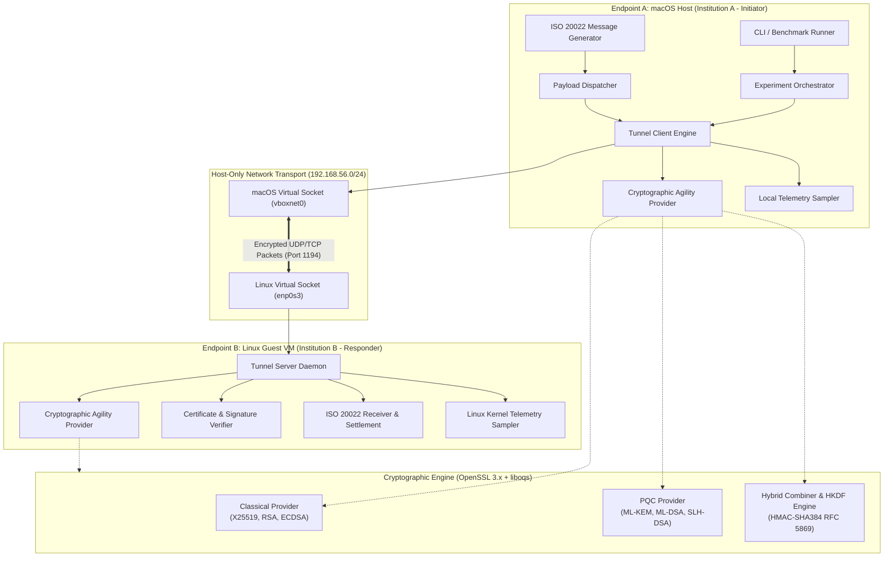
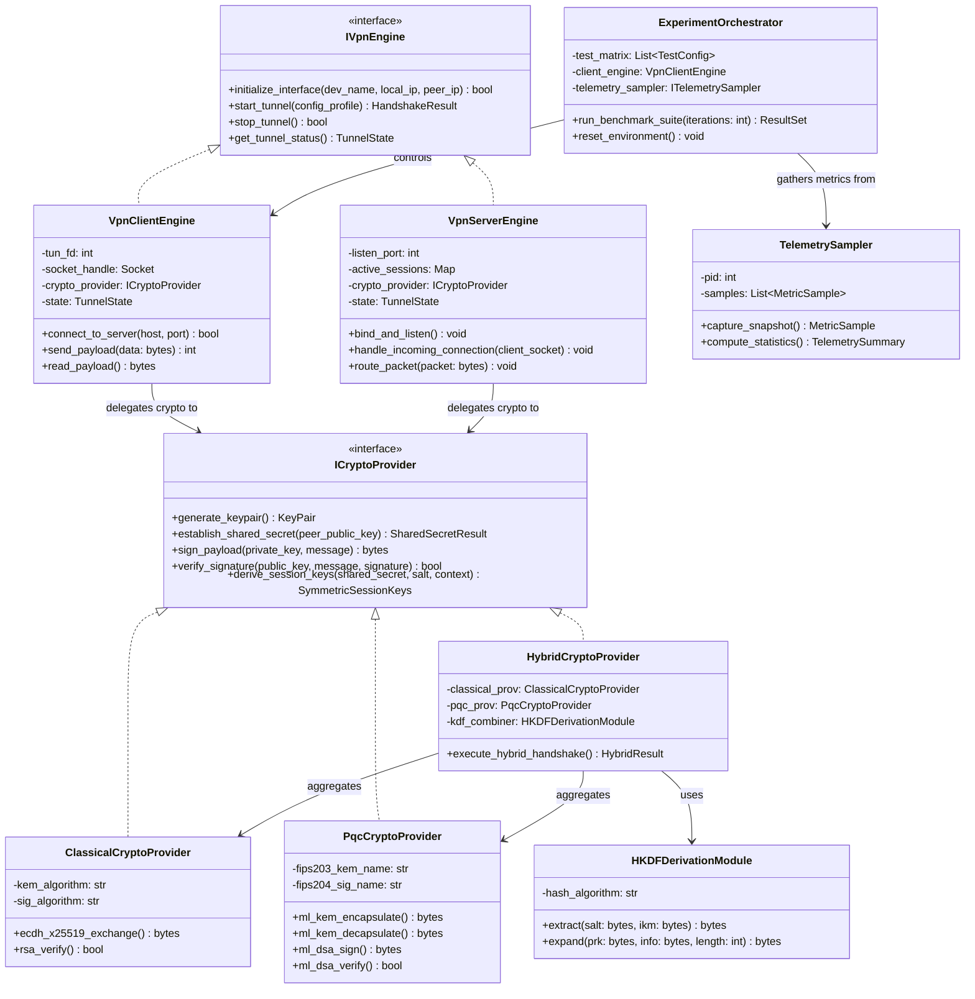
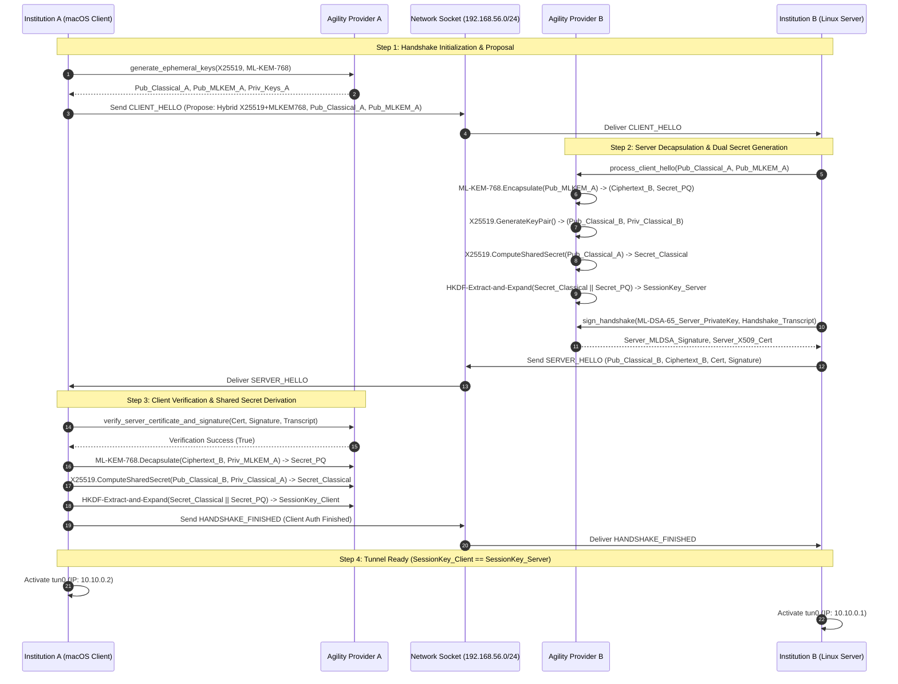
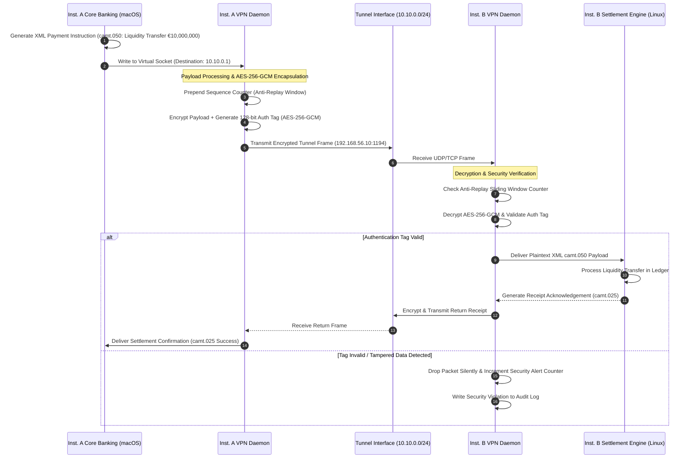
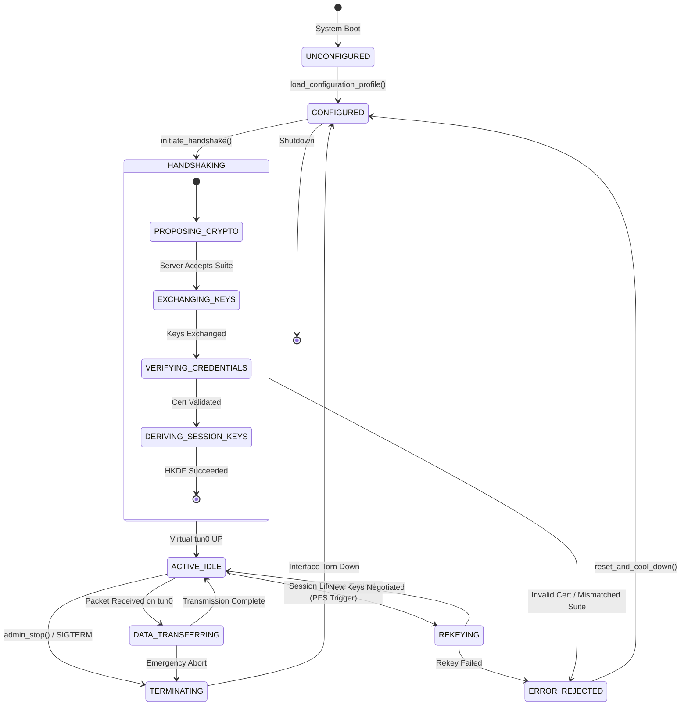
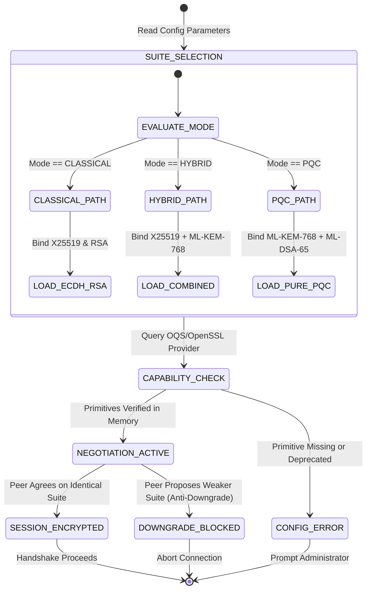

# SYSTEM ARCHITECTURE & UML DESIGN SPECIFICATION

## Project Title
**Hybrid Post-Quantum Secure VPN for Inter-Bank Communication**

**Document Version:** 1.0  
**Status:** Approved Design Baseline  
**Date:** September 2026  
**Institution:** University of Dodoma (UDOM)  
**College:** College of Informatics and Virtual Education (CIVE)  
**Department:** Department of Computer Science and Software Engineering  
**Programme:** Bachelor of Science in Software Engineering  

---

## Table of Contents
1. [Introduction & Architectural Goals](#1-introduction--architectural-goals)
   - 1.1 Purpose
   - 1.2 Architectural Principles & Design Philosophy
   - 1.3 High-Level System Decomposition
2. [Component Architecture](#2-component-architecture)
   - 2.1 Initiator Node Architecture (Institution A - macOS)
   - 2.2 Responder Node Architecture (Institution B - Linux VM)
   - 2.3 Cryptographic Agility Subsystem
   - 2.4 Financial Workload Simulation Subsystem
   - 2.5 Automated Telemetry & Benchmarking Subsystem
3. [Component Diagram (UML)](#3-component-diagram-uml)
4. [Class Structural Design & Object Models](#4-class-structural-design--object-models)
   - 4.1 Interface Specifications (`IVpnEngine`, `ICryptoProvider`, etc.)
   - 4.2 Class Hierarchy & Unified Class Diagram (UML)
5. [Dynamic Behavioral Models (Sequence Diagrams)](#5-dynamic-behavioral-models-sequence-diagrams)
   - 5.1 Sequence 1: Hybrid Mutual Authentication & Key Establishment
   - 5.2 Sequence 2: ISO 20022 Financial Settlement Dispatch
   - 5.3 Sequence 3: Automated Benchmark & Telemetry Gathering Loop
6. [State Machine Models](#6-state-machine-models)
   - 6.1 VPN Tunnel Lifecycle State Machine
   - 6.2 Cryptographic Negotiation & Agility State Machine
7. [Deployment Architecture](#7-deployment-architecture)
   - 7.1 Physical and Virtualized Infrastructure Mapping
   - 7.2 Deployment Diagram (UML)
   - 7.3 Network Interface and Subnet Bindings
8. [Data Models & Schema Specifications](#8-data-models--schema-specifications)
   - 8.1 Declarative Configuration Schema (`vpn_config.json`)
   - 8.2 Telemetry Record Schema (`telemetry_metric.json`)
   - 8.3 Simulated Financial Payload Format (`camt.050.xml`)
9. [Architecture Traceability Matrix](#9-architecture-traceability-matrix)

---

## 1. Introduction & Architectural Goals

### 1.1 Purpose
This document presents the detailed architectural blueprint and Unified Modeling Language (UML) specifications for the **Hybrid Post-Quantum Cryptographic VPN** designed for simulated inter-bank communication. It translates the functional requirements (FR-01 to FR-20) and non-functional requirements (NFR-01 to NFR-14) outlined in the SRS into structural components, object-oriented abstractions, dynamic sequences, state behaviors, and deployment topologies.

### 1.2 Architectural Principles & Design Philosophy
The system adheres to four foundational architectural principles:
1. **Decoupled Cryptographic Agility (Provider Pattern):** The network transport layer (sockets, packet encapsulation, TUN/TAP management) is completely decoupled from cryptographic primitives. Cryptographic mechanisms are exposed via an abstract provider interface, allowing seamless substitution between Classical, PQC, and Hybrid algorithms.
2. **Defense-in-Depth Hybridization:** In accordance with NIST IR 8547 and BSI recommendations, the system enforces simultaneous classical (ECDH/X25519) and post-quantum (ML-KEM-768) key exchange combined via HKDF-SHA384. Decryption requires breaking both mathematical barriers.
3. **Layered Isolation (Overlay vs. Underlay):** The architecture cleanly separates the untrusted underlay transport (`192.168.56.0/24`) from the authenticated overlay virtual network (`10.10.0.0/24`), ensuring zero payload exposure over the physical/virtual transport channel.
4. **Deterministic Telemetry & Empirical Reproducibility:** Benchmarking and monitoring capabilities are integrated directly into the software architecture, enabling non-intrusive, automated collection of handshake latency, throughput, CPU spikes, and memory consumption.

### 1.3 High-Level System Decomposition
The software is divided into four cohesive subsystems across two communicating nodes:
- **Subsystem 1 (Network & Tunnel Engine):** Manages virtual TUN interfaces, IP routing tables, packet encapsulation, and socket transmission.
- **Subsystem 2 (Cryptographic Agility Controller):** Handles algorithm negotiation, key generation, encapsulation/decapsulation, certificate validation, and key derivation.
- **Subsystem 3 (Financial Payload Engine):** Formats, signs, transmits, and validates ISO 20022 XML financial payment messages.
- **Subsystem 4 (Benchmarking & Telemetry Harness):** Automates multi-trial experiment execution, captures process-level metrics, and exports statistical datasets.

---

## 2. Component Architecture

### 2.1 Initiator Node Architecture (Institution A - macOS)
Endpoint A acts as the initiating central banking client:
- **`TunnelClientService`:** Manages the client-side TUN device (`tun0`), binds to local IP `10.10.0.2`, and routes outgoing payment traffic through the tunnel.
- **`ClientHandshakeHandler`:** Formulates client hello requests, presents ML-DSA certificates, and transmits hybrid key exchange proposals.
- **`PayloadDispatcher`:** Ingests ISO 20022 XML messages, checks tunnel status, and pushes packets into the virtual network socket.
- **`LocalTelemetryCollector`:** Runs asynchronously to monitor macOS CPU usage, resident memory (RSS), and round-trip socket ping times.

### 2.2 Responder Node Architecture (Institution B - Linux VM)
Endpoint B acts as the receiving central banking server gateway:
- **`TunnelServerService`:** Operates as a daemon listening on the host-only IP (`192.168.56.10:1194`), binding to virtual IP `10.10.0.1`.
- **`ServerHandshakeHandler`:** Evaluates incoming client proposals, validates client certificate chains against trusted root CAs, decapsulates ML-KEM secrets, and derives session keys.
- **`PayloadReceiver`:** Listens on virtual IP `10.10.0.1`, unpacks incoming ISO 20022 XML payments, verifies message structure, and generates receipt confirmations (`camt.025`).
- **`ServerTelemetrySampler`:** Queries the Linux `/proc` filesystem and kernel counters to capture CPU load and memory usage during handshake and transmission bursts.

### 2.3 Cryptographic Agility Subsystem
This subsystem abstracts the cryptographic lifecycle through three provider modules:
- **`ClassicalCryptoProvider`:** Wraps standard OpenSSL 3.x routines for ECDH (X25519) key exchange, RSA-2048/4096 signing, and SHA-256 hashing.
- **`PqcCryptoProvider`:** Wraps Open Quantum Safe (liboqs / OQS Provider) primitives for NIST FIPS 203 (ML-KEM-512/768/1024), FIPS 204 (ML-DSA-44/65/87), and FIPS 205 (SLH-DSA).
- **`HybridCryptoProvider`:** Coordinates parallel execution of classical and PQC primitives, feeding raw shared secrets into the `HKDFDerivationModule`.
- **`HKDFDerivationModule`:** Executes HMAC-based Extract-and-Expand key derivation (RFC 5869) using SHA-384:
  $$\text{PRK} = \text{HMAC-SHA384}(\text{Salt}, S_{\text{classical}} \mathbin{\Vert} S_{\text{pqc}})$$
  $$\text{SessionKey} = \text{HKDF-Expand}(\text{PRK}, \text{"PQC-HYBRID-VPN-SESSION-KEY"}, 32)$$

### 2.4 Financial Workload Simulation Subsystem
Emulates realistic central bank and RTGS inter-bank data exchange:
- **`XmlMessageBuilder`:** Generates schema-valid ISO 20022 XML documents (`camt.050.001.05` for liquidity transfers, `pacs.008.001.08` for customer credit transfers).
- **`BusinessApplicationHeaderHandler`:** Injects and parses the ISO 20022 `head.001.001.01` (BAH) wrapper containing message routing identifiers, timestamps, and application-level digital signatures.

### 2.5 Automated Telemetry & Benchmarking Subsystem
Coordinates scientific experiment runs without human intervention:
- **`ExperimentOrchestrator`:** Reads experiment definition matrices, iterates across parameter permutations (Modes, Key Sizes, Payload Volumes), and resets daemon processes between trials.
- **`MetricsAggregator`:** Computes mean, median, standard deviation, and 95th percentile distributions from raw log timestamps and resource samples.
- **`DatasetExporter`:** Serializes structured benchmark results to CSV and JSON formats for analysis in Python/R.

---

## 3. Component Diagram (UML)

The following UML Component Diagram illustrates the internal structural components, interfaces, and dependencies across both endpoints:



---

## 4. Class Structural Design & Object Models

### 4.1 Interface Specifications

#### 1. `IVpnEngine` Interface
```python
class IVpnEngine(ABC):
    @abstractmethod
    def initialize_interface(self, dev_name: str, local_ip: str, peer_ip: str) -> bool:
        """Configures virtual tun device and allocates IP addresses."""
        pass

    @abstractmethod
    def start_tunnel(self, config_profile: VpnConfigProfile) -> HandshakeResult:
        """Executes cryptographic handshake and opens the tunnel."""
        pass

    @abstractmethod
    def stop_tunnel(self) -> bool:
        """Tears down the virtual interface and releases socket bindings."""
        pass

    @abstractmethod
    def get_tunnel_status(self) -> TunnelState:
        """Returns current operational lifecycle state of the tunnel."""
        pass
```

#### 2. `ICryptoProvider` Interface
```python
class ICryptoProvider(ABC):
    @abstractmethod
    def generate_keypair(self) -> KeyPair:
        """Generates public and private key material for the configured algorithm."""
        pass

    @abstractmethod
    def establish_shared_secret(self, peer_public_key: bytes) -> SharedSecretResult:
        """Executes key exchange or encapsulation to produce a shared secret."""
        pass

    @abstractmethod
    def sign_payload(self, private_key: bytes, message: bytes) -> bytes:
        """Computes digital signature using configured signing algorithm."""
        pass

    @abstractmethod
    def verify_signature(self, public_key: bytes, message: bytes, signature: bytes) -> bool:
        """Verifies signature correctness against sender public key."""
        pass

    @abstractmethod
    def derive_session_keys(self, shared_secret: bytes, salt: bytes, context: bytes) -> SymmetricSessionKeys:
        """Applies HKDF to derive encryption, integrity, and IV parameters."""
        pass
```

#### 3. `ITelemetrySampler` Interface
```python
class ITelemetrySampler(ABC):
    @abstractmethod
    def start_sampling(self, target_pid: int, interval_ms: int) -> None:
        """Begins non-blocking sampling of CPU and RSS memory metrics."""
        pass

    @abstractmethod
    def stop_sampling(self) -> TelemetrySummary:
        """Concludes sampling and calculates peak, average, and standard deviation."""
        pass
```

---

### 4.2 Class Hierarchy & Unified Class Diagram (UML)



---

## 5. Dynamic Behavioral Models (Sequence Diagrams)

### 5.1 Sequence 1: Hybrid Mutual Authentication & Key Establishment
Details the exact message exchange, dual key encapsulation, and key derivation pipeline during tunnel setup:



---

### 5.2 Sequence 2: ISO 20022 Financial Settlement Dispatch
Illustrates how higher-level inter-bank payment messages are encapsulated, encrypted, and verified across the virtual network:



---

### 5.3 Sequence 3: Automated Benchmark & Telemetry Gathering Loop
Demonstrates how the experimental harness executes multi-trial benchmark batches and collects system telemetry:

```mermaid
sequenceDiagram
    autonumber
    participant Bench as Experiment Orchestrator
    participant Client as VPN Client Process
    participant LinuxSampler as Linux Telemetry Daemon (SSH/Socket)
    participant MacSampler as macOS Local Sampler
    participant DB as CSV/JSON Telemetry Storage

    loop For Iteration i = 1 to 50
        Bench->>MacSampler: start_sampling(Client_PID, Interval=10ms)
        Bench->>LinuxSampler: start_sampling(Server_PID, Interval=10ms)
        
        Note over Bench,Client: Measure Handshake Phase
        Bench->>Bench: t0 = high_resolution_clock()
        Bench->>Client: trigger_tunnel_connect(Mode=HYBRID, KEM=ML-KEM-768)
        Client-->>Bench: tunnel_connected_event(tun0_up)
        Bench->>Bench: t1 = high_resolution_clock(); handshake_duration = t1 - t0

        Note over Bench,Client: Measure Transmission Phase
        Bench->>Client: send_test_workload(Payload=10MB_Bulk_Data)
        Client-->>Bench: workload_complete_event()
        Bench->>Bench: t2 = high_resolution_clock(); transfer_rate = calculate_mbps()

        Bench->>MacSampler: stop_sampling()
        MacSampler-->>Bench: (Mac_Peak_CPU, Mac_Avg_CPU, Mac_Max_RSS)
        Bench->>LinuxSampler: stop_sampling()
        LinuxSampler-->>Bench: (Linux_Peak_CPU, Linux_Avg_CPU, Linux_Max_RSS)

        Bench->>Client: trigger_tunnel_disconnect()
        Client-->>Bench: tunnel_terminated_event()

        Bench->>DB: write_trial_record(Trial_ID=i, Mode=HYBRID, Handshake_ms, Transfer_Mbps, CPU, RAM)
        Bench->>Bench: sleep(2.0 seconds)  # Cool down system
    end
```

---

## 6. State Machine Models

### 6.1 VPN Tunnel Lifecycle State Machine



### 6.2 Cryptographic Negotiation & Agility State Machine



---

## 7. Deployment Architecture

### 7.1 Physical and Virtualized Infrastructure Mapping
The system deployment bridges host user-space execution and hypervisor guest virtualization:

```
+-----------------------------------------------------------------------------------------------+
| PHYSICAL HOST: Apple Mac (macOS Sonoma / Sequoia)                                             |
|                                                                                               |
|  +----------------------------------------------------+                                       |
|  | User-Space Processes (Institution A)               |                                       |
|  | - Python 3.10+ Benchmark Orchestrator              |                                       |
|  | - OpenVPN / strongSwan Client Process (PID 14210)  |                                       |
|  | - OpenSSL 3.x with liboqs / OQS Provider           |                                       |
|  +----------------------------------------------------+                                       |
|                            |                                                                  |
|  +----------------------------------------------------+                                       |
|  | macOS Virtual Network Interfaces                   |                                       |
|  | - tun0: IP 10.10.0.2 / 24 (Overlay Tunnel)         |                                       |
|  | - vboxnet0: IP 192.168.56.1 / 24 (Host-Only)       |                                       |
|  +----------------------------------------------------+                                       |
+-----------------------------------------------------------------------------------------------+
                                             |
                   [ VirtualBox Internal Virtual Switch: 192.168.56.0/24 ]
                                             |
+-----------------------------------------------------------------------------------------------+
| GUEST VIRTUAL MACHINE: Ubuntu Linux 22.04 / 24.04 LTS (Oracle VM VirtualBox)                 |
|                                                                                               |
|  +----------------------------------------------------+                                       |
|  | Linux Guest Interfaces                             |                                       |
|  | - enp0s3: IP 192.168.56.10 / 24 (Virtual NIC)      |                                       |
|  | - tun0: IP 10.10.0.1 / 24 (Overlay Tunnel)         |                                       |
|  +----------------------------------------------------+                                       |
|                            |                                                                  |
|  +----------------------------------------------------+                                       |
|  | Linux Daemon Processes (Institution B)             |                                       |
|  | - OpenVPN / strongSwan Server Daemon (PID 845)     |                                       |
|  | - ISO 20022 XML Settlement Processing Listener    |                                       |
|  | - System Telemetry Monitor (/proc, sysfs, iperf3)  |                                       |
|  +----------------------------------------------------+                                       |
+-----------------------------------------------------------------------------------------------+
```

### 7.2 Deployment Diagram (UML)

```mermaid
deployment
    node "MacBook Physical Host" as MacHost {
        artifact "benchmark_runner.py" as BenchScript
        artifact "vpn_client.conf" as ClientConf
        node "macOS OS Environment" {
            component "OpenVPN / strongSwan Client" as ClientDaemon
            component "OQS Provider Shared Library (.dylib)" as MacOqs
            interface "tun0 (10.10.0.2)" as TunClient
            interface "vboxnet0 (192.168.56.1)" as MacHostNet
        }
    }

    node "VirtualBox Hypervisor" as VBox {
        node "Ubuntu Linux Guest VM" as LinuxVM {
            artifact "vpn_server.conf" as ServerConf
            artifact "settlement_receiver.py" as ReceiverScript
            node "Linux Kernel Environment" {
                component "OpenVPN / strongSwan Server Daemon" as ServerDaemon
                component "OQS Provider Shared Library (.so)" as LinuxOqs
                interface "tun0 (10.10.0.1)" as TunServer
                interface "enp0s3 (192.168.56.10)" as LinuxVNic
            }
        }
    }

    MacHostNet -- LinuxVNic : Host-Only Bus (192.168.56.0/24)
    TunClient .. TunServer : Encrypted Virtual Overlay (10.10.0.0/24)
    ClientDaemon --> MacOqs : dynamically links
    ServerDaemon --> LinuxOqs : dynamically links
    BenchScript --> ClientDaemon : controls
    ReceiverScript --> ServerDaemon : listens via tun0
```

---

## 8. Data Models & Schema Specifications

### 8.1 Declarative Configuration Schema (`vpn_config.json`)
The operational profile of both endpoints is driven by a declarative JSON schema:

```json
{
  "$schema": "https://json-schema.org/draft/2020-12/schema",
  "title": "VpnConfigurationProfile",
  "type": "object",
  "properties": {
    "node_role": {
      "type": "string",
      "enum": ["INITIATOR_CLIENT", "RESPONDER_SERVER"]
    },
    "network": {
      "type": "object",
      "properties": {
        "underlay_remote_ip": { "type": "string", "format": "ipv4" },
        "underlay_port": { "type": "integer", "default": 1194 },
        "tunnel_local_ip": { "type": "string", "format": "ipv4" },
        "tunnel_subnet_mask": { "type": "string", "default": "255.255.255.0" },
        "mtu_bytes": { "type": "integer", "default": 1500 }
      },
      "required": ["underlay_remote_ip", "underlay_port", "tunnel_local_ip"]
    },
    "cryptography": {
      "type": "object",
      "properties": {
        "operational_mode": {
          "type": "string",
          "enum": ["MODE_CLASSICAL", "MODE_HYBRID", "MODE_PQC"]
        },
        "classical_kem_group": {
          "type": "string",
          "enum": ["X25519", "secp256r1", "secp384r1"]
        },
        "pqc_kem_algorithm": {
          "type": "string",
          "enum": ["ML-KEM-512", "ML-KEM-768", "ML-KEM-1024"]
        },
        "signature_algorithm": {
          "type": "string",
          "enum": ["RSA-2048", "ECDSA-P256", "ML-DSA-44", "ML-DSA-65", "ML-DSA-87", "SLH-DSA-128f"]
        },
        "bulk_cipher": {
          "type": "string",
          "default": "AES-256-GCM"
        },
        "hkdf_hash_function": {
          "type": "string",
          "default": "SHA-384"
        }
      },
      "required": ["operational_mode", "bulk_cipher"]
    },
    "certificates": {
      "type": "object",
      "properties": {
        "ca_cert_path": { "type": "string" },
        "entity_cert_path": { "type": "string" },
        "private_key_path": { "type": "string" }
      },
      "required": ["ca_cert_path", "entity_cert_path", "private_key_path"]
    }
  },
  "required": ["node_role", "network", "cryptography", "certificates"]
}
```

### 8.2 Telemetry Record Schema (`telemetry_metric.json`)
Every benchmark execution generates machine-readable telemetry objects:

```json
{
  "$schema": "https://json-schema.org/draft/2020-12/schema",
  "title": "BenchmarkTrialRecord",
  "type": "object",
  "properties": {
    "trial_id": { "type": "integer" },
    "timestamp_iso": { "type": "string", "format": "date-time" },
    "configuration": {
      "mode": { "type": "string" },
      "kem_algorithm": { "type": "string" },
      "sig_algorithm": { "type": "string" },
      "cipher": { "type": "string" }
    },
    "timings_ms": {
      "socket_connect_ms": { "type": "number" },
      "crypto_handshake_ms": { "type": "number" },
      "total_tunnel_estab_ms": { "type": "number" },
      "icmp_rtt_mean_ms": { "type": "number" }
    },
    "throughput": {
      "payload_size_bytes": { "type": "integer" },
      "transfer_duration_sec": { "type": "number" },
      "effective_mbps": { "type": "number" }
    },
    "system_resources": {
      "client_peak_cpu_percent": { "type": "number" },
      "client_avg_cpu_percent": { "type": "number" },
      "client_rss_memory_mb": { "type": "number" },
      "server_peak_cpu_percent": { "type": "number" },
      "server_avg_cpu_percent": { "type": "number" },
      "server_rss_memory_mb": { "type": "number" }
    },
    "network_overhead": {
      "handshake_packets_sent": { "type": "integer" },
      "handshake_bytes_sent": { "type": "integer" },
      "fragmented_ip_packets": { "type": "integer" }
    }
  },
  "required": ["trial_id", "timestamp_iso", "configuration", "timings_ms", "system_resources"]
}
```

### 8.3 Simulated Financial Payload Format (`camt.050.xml`)
The test payload complies with the ISO 20022 liquidity transfer schema:

```xml
<?xml version="1.0" encoding="UTF-8"?>
<Document xmlns="urn:iso:std:iso:20022:tech:xsd:camt.050.001.05">
    <LqdtyTrf>
        <MsgHdr>
            <MsgId>INSTA-2026-LIQ-00042</MsgId>
            <CreDtTm>2026-09-26T21:30:00Z</CreDtTm>
        </MsgHdr>
        <LqdtyTrfData>
            <TrfId>
                <Ref>TRF-BDF-BUBA-99482</Ref>
            </TrfId>
            <Amt>
                <AmtWthtCcy>10000000.00</AmtWthtCcy>
            </Amt>
            <CdtrAgt>
                <FinInstnId>
                    <BICFI>MARKETBXXX</BICFI>
                </FinInstnId>
            </CdtrAgt>
            <DbtrAgt>
                <FinInstnId>
                    <BICFI>MARKETAXXX</BICFI>
                </FinInstnId>
            </DbtrAgt>
        </LqdtyTrfData>
    </LqdtyTrf>
</Document>
```

---

## 9. Architecture Traceability Matrix

| Component / Subsystem | Implemented Functional Requirements | Satisfied Non-Functional Requirements | Architectural Verification Method |
| :--- | :--- | :--- | :--- |
| **`TunnelClientEngine` & `TunnelServerEngine`** | FR-01, FR-02, FR-03, FR-11, FR-12 | NFR-03, NFR-07, NFR-08, NFR-10 | Automated Socket & Interface Tests |
| **`ClassicalCryptoProvider`** | FR-04, FR-08 | NFR-01, NFR-04 | Baseline Cryptographic Benchmark |
| **`PqcCryptoProvider`** | FR-05, FR-09 | NFR-01, NFR-02 | NIST Vector & liboqs Output Verification |
| **`HybridCryptoProvider` & `HKDFDerivationModule`** | FR-06, FR-10 | NFR-01, NFR-03, NFR-04 | Key Derivation Unit Test & Handshake Trace |
| **`BusinessApplicationHeaderHandler` & Payloads** | FR-13 | NFR-05 | End-to-End XML Transmission Test |
| **`CryptographicAgilityController`** | FR-07, FR-14, FR-15 | NFR-05, NFR-11 | Algorithm Deprecation & Reconfig Tests |
| **`ExperimentOrchestrator` & `TelemetrySampler`** | FR-16, FR-17, FR-18, FR-19, FR-20 | NFR-06, NFR-12, NFR-13, NFR-14 | Multi-Trial Automated Experiment ($N=50$) |

---
*End of System Architecture & UML Design Specification (v1.0)*
